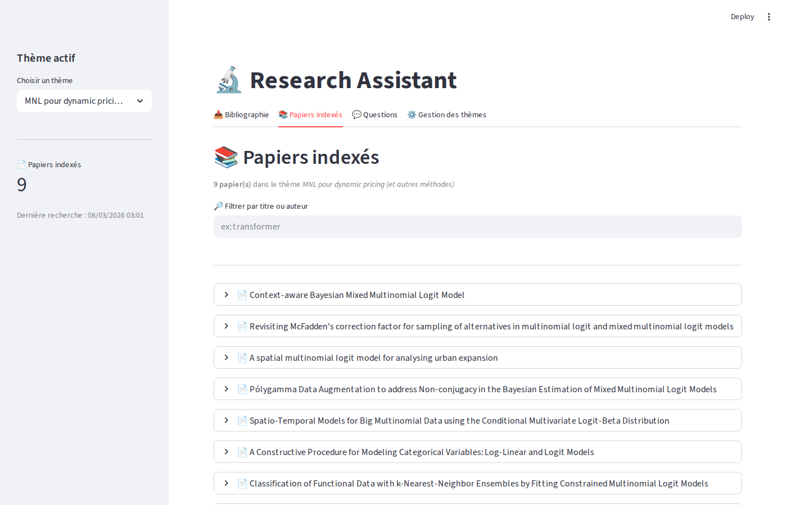

# Research Assistant

Streamlit app and MCP server for searching, scoring, and indexing academic papers, with a RAG-based Q&A interface.

Keeping up with the literature on a topic means skimming dozens of abstracts to find the few papers worth reading. This tool lets a local LLM do the first pass: it plans the search queries, scores each paper for relevance, indexes the good ones, and answers questions over them with citations. Everything runs locally with Ollama: no paper or question leaves your machine.

## Features

- Search papers from **ArXiv** and **Semantic Scholar**
- LLM-based relevance scoring per paper
- PDF download and indexing into a local vector store (ChromaDB)
- Q&A over indexed papers via RAG
- Theme-based organisation (one vector store per research topic)

## Architecture

```
app.py                   # Streamlit entry point
core/
  research_agent.py      # Search + scoring pipeline (LangChain + Ollama)
  rag_agent.py           # Q&A agent over indexed papers
  paper_fetcher.py       # PDF download
  vector_store.py        # ChromaDB wrapper
  theme_manager.py       # Theme persistence (JSON)
  logger.py              # Loguru setup
  sources/
    arxiv.py             # ArXiv source
    semantic_scholar.py  # Semantic Scholar source (with rate-limit retry)
tabs/
  bibliography.py        # Search & scoring tab
  papers.py              # Indexed papers tab
  qa.py                  # Q&A tab
data/                    # PDFs and ChromaDB, organised by theme slug
```

## Prerequisites

- [Ollama](https://ollama.com) running locally
- [uv](https://docs.astral.sh/uv/) for dependency management

Required Ollama models:

```bash
ollama pull qwen3.5:9b          # search & Q&A
ollama pull qwen2.5:3b          # paper scoring
ollama pull nomic-embed-text    # embeddings
```

## Installation

```bash
uv sync
```

## Running

```bash
uv run streamlit run app.py
```



### MCP server

`mcp_server.py` exposes the research functions (themes, search, indexing, Q&A) as an MCP server, e.g. for Claude Code:

```bash
claude mcp add research-tool -- /path/to/research_tool/mcp_server.sh
```

Tools exposed:

| Tool | What it does |
|---|---|
| `list_research_themes` | List themes and how many papers each one holds |
| `create_research_theme` | Create a theme (one vector store per theme) |
| `list_indexed_papers` | List the papers indexed in a theme |
| `search_and_index_papers` | Search, score, download and index papers on a topic |
| `ask_question` | Answer a question from the indexed papers, with citations |

Example prompt from Claude Code: *"Create a theme 'LLM evaluation', index the most relevant recent papers on benchmark contamination, then summarise the main detection methods."*

## Configuration

Copy `.env.example` to `.env` and fill in the values.

| Environment variable | Description | Default |
|---|---|---|
| `SEMANTIC_SCHOLAR_API_KEY` | Semantic Scholar API key (optional, increases rate limits) | — |

## Pipeline

**Phase 1 — Search** (`qwen3.5:9b`): the agent generates 2-3 optimised queries and calls the configured source tools (ArXiv, Semantic Scholar).

**Phase 2 — Scoring** (`qwen2.5:3b`): each paper is scored 1-10 for relevance to the research subject. Papers below the minimum score threshold are discarded.

**Indexing**: accepted PDFs are downloaded and chunked into ChromaDB via `nomic-embed-text` embeddings.

**Q&A**: the RAG agent retrieves relevant chunks and answers questions using `qwen3.5:9b`.

## Tests and code quality

```bash
uv run pytest             # tests (HTTP calls mocked: no network or Ollama needed)
uv run ruff check .       # lint
uv run ruff format .      # format
```

The tests cover the source adapters (retry on rate limits, Semantic Scholar parsing and ID scheme), the parsing of LLM scoring output, theme persistence and the MCP tool surface.